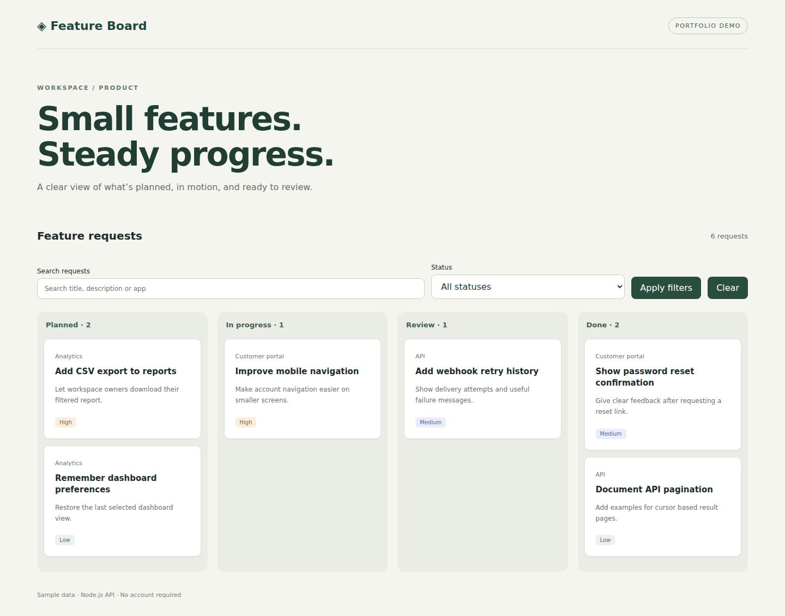

# Feature Board

A responsive feature-request workspace with a Node.js HTTP API and browser JavaScript. A portfolio demo using fictional data.

**[Review the search/filter PR](https://github.com/malafay9-ai/feature-board-demo/pull/1)** · **[See passing checks](https://github.com/malafay9-ai/feature-board-demo/actions/runs/42643467442)**



## Explore the feature

The `main` branch contains the baseline board. The open PR adds search and status filters, including combined queries, an empty state, a Clear button and protection against stale responses.

To run the feature locally:

```sh
git clone https://github.com/malafay9-ai/feature-board-demo.git
cd feature-board-demo
git switch feature/search-and-status-filters
npm start
```

Requires Node.js 22 or newer. Open http://127.0.0.1:3000. The application has no dependencies or install step. Run `npm test` for API integration tests.

## What is included

| Area | Details |
| --- | --- |
| Interface | Four status columns, responsive layout, labelled controls |
| API | Read-only requests endpoint; search and validated status filters in the PR |
| Tests | 5 API integration tests; browser flow, error checks and mobile overflow checks |
| Evidence | Desktop, filtered and mobile screenshots in the PR |

## Scope

This is sample work, not a previous client project. Data is in memory, with no authentication, persistence or editing. The app is a focused demonstration rather than a production task-management service.

Prepared with ChatGPT/Codex assistance. Claude Code was not used.
